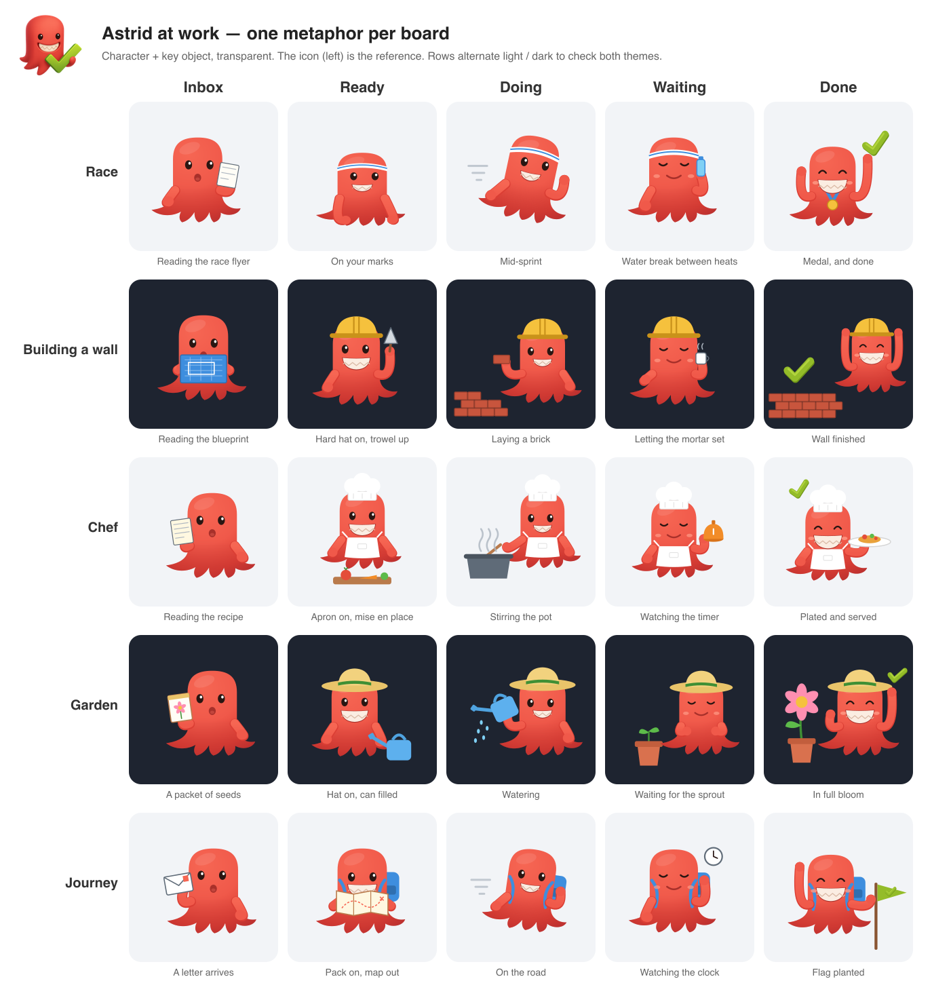

# Empathy board states — the octopus at work (ADEV-127)

The Astrid icon's octopus acting out each board state, in five metaphors. **One metaphor per
board** (Jon, 2026-11-19): every column of a view speaks the same metaphor, and all five are in
rotation across boards.

Second pass: only the character, its costume and one key object, on a **transparent** background,
and the character redrawn from `astrid-web/public/images/astrid-character.png`: the capsule body
with outward-curling tentacles, the sampled coral, the big wide-set eyes and the cream zigzag grin.

| Metaphor | Inbox | Ready | Doing | Waiting | Done |
|---|---|---|---|---|---|
| Race | reading the flyer | on your marks | mid-sprint | water break | medal |
| Building a wall | blueprint | hard hat, trowel | laying a brick | mortar setting (coffee) | finished |
| Chef | recipe | apron, mise en place | stirring | kitchen timer | plated |
| Garden | seed packet | hat, can filled | watering | sprout coming | bloom |
| Journey | letter arrives | pack + map | on the road | watching the clock | flag planted |

- `svg/<metaphor>-<state>.svg`: 512×512, transparent, with no text, so any locale and either theme can use them.
- `generate.mjs`: the source. One shared octopus (`octo()`: faces `curious`, `grin`,
  `focus`, `calm`, `joy`, with posable arms) and one key object per scene. The contact sheet puts
  the icon beside the title and alternates light and dark rows. Edit it, then run
  `node docs/design/empathy-states/generate.mjs`. It needs `sharp` from the paired astrid-web
  checkout for the contact sheet.

These are exploration art and are not in the app bundle. Once a set is picked, it goes into
`Assets.xcassets` as its own change.
