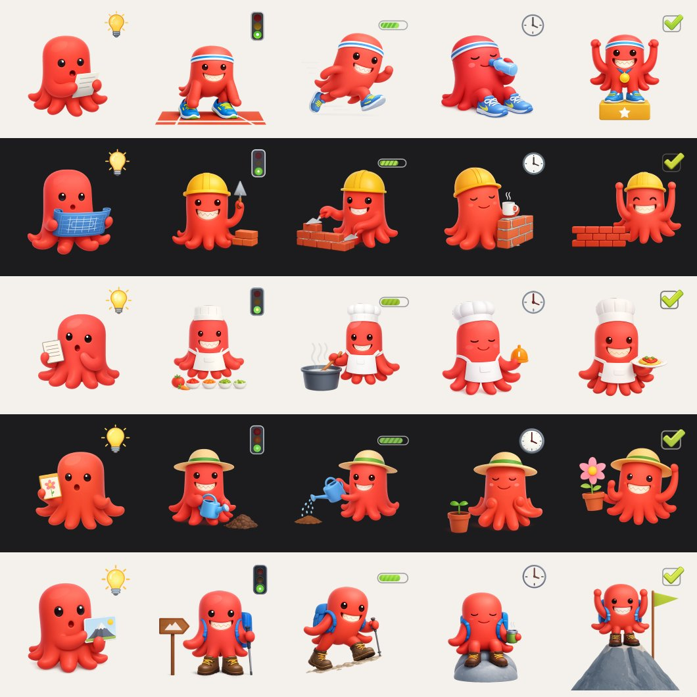

# Empathy board states — the octopus at work (ADEV-127)

The Astrid icon's octopus acting out each board state, in five metaphors. **One metaphor per
board** (Jon, 2026-11-19): every column of a view speaks the same metaphor, and all five are in
rotation across boards.

Second pass: only the character, its costume and one key object, on a **transparent** background,
and the character redrawn from `astrid-web/public/images/astrid-character.png`: the capsule body
with outward-curling tentacles, the sampled coral, the big wide-set eyes and the cream zigzag grin.

Third pass (Jon, 2026-11-19): the tentacles redrawn as the icon's fat, round-ended tubes that grow
out of the body on one gradient (no hem seam), the arms likewise; and **a state marker in every
frame**, top right and identical whatever the metaphor, so the state reads first:

| State | Marker |
|---|---|
| Inbox (Ideas) | lit light bulb |
| Ready | traffic light on green |
| Doing | progress bar, about two-thirds |
| Waiting | clock |
| Done | ticked checkbox (the icon's check) |

The scenes' own loose checks went, since the checkbox carries Done, and Journey's Waiting is now a
bus stop so the clock is not shown twice.

Fourth pass (Jon, 2026-11-19): the **Race** gets running shoes, a stretch of track with the start
line for Ready, and a podium for Done; **Journey became a Hike**, which starts at a trailhead sign
and ends on the summit with the flag planted. The hiker wears boots, so in both sets the
costume says which metaphor it is before the props do.

Fifth pass (Jon, 2026-11-19): **high fidelity**. The 25 poses were rendered in the icon's soft 3D
look by an image model (`gpt-image-1.5`, transparent background), with the app icon as the
character reference and each vector frame as the pose sketch: `hifi/render.mjs`, then
`hifi/contact.mjs`. These are `hifi/webp/<metaphor>-<state>.webp`, 1024², about 100 KB each.
They are **optional extras**, not bundled. The app's existing empty-column art stays the
built-in default. The server hosts the hi-fi set, and clients fetch it when idle, rotating
each list through the metaphors daily.

| Metaphor | Inbox | Ready | Doing | Waiting | Done |
|---|---|---|---|---|---|
| Race | reading the flyer | shoes on, at the start line | mid-sprint | water break | podium, medal |
| Building a wall | blueprint | hard hat, trowel | laying a brick | mortar setting (coffee) | finished |
| Chef | recipe | apron, mise en place | stirring | kitchen timer | plated |
| Garden | seed packet | hat, can filled | watering | sprout coming | bloom |
| Hike | postcard of the mountain | boots on, at the trailhead | climbing the trail | resting on a rock | summit, flag planted |

- `svg/<metaphor>-<state>.svg`: 512×512, transparent, with no text, so any locale and either theme can use them.
- `generate.mjs`: the source. One shared octopus (`octo()`: faces `curious`, `grin`,
  `focus`, `calm`, `joy`, with posable arms) and one key object per scene. The contact sheet puts
  the icon beside the title and alternates light and dark rows. Edit it, then run
  `node docs/design/empathy-states/generate.mjs`. It needs `sharp` from the paired astrid-web
  checkout for the contact sheet.

The vector set is exploration art and is not in the app bundle. The hi-fi set reaches the apps
from the server, never from the bundle.
